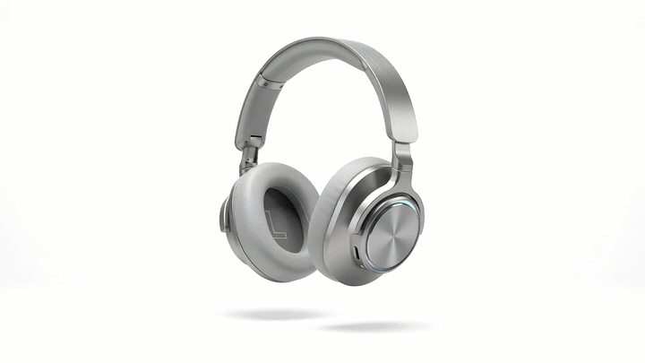
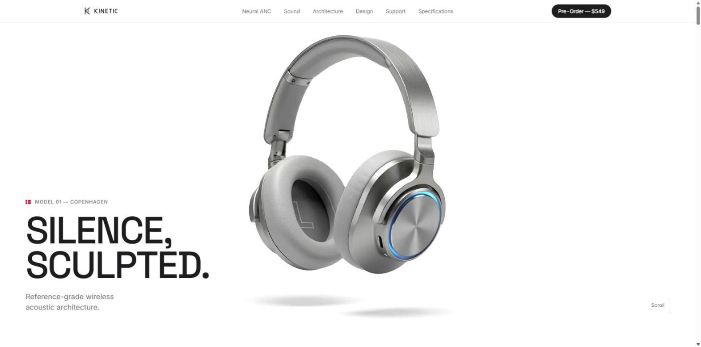
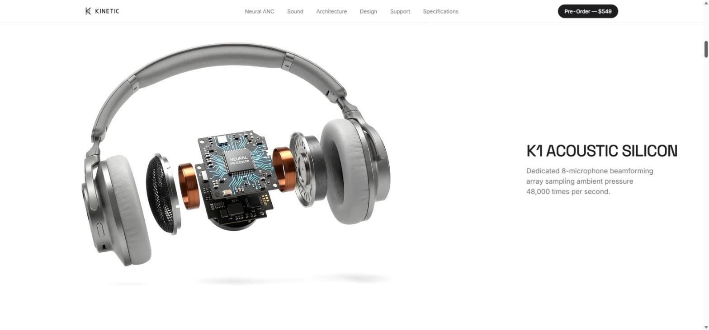
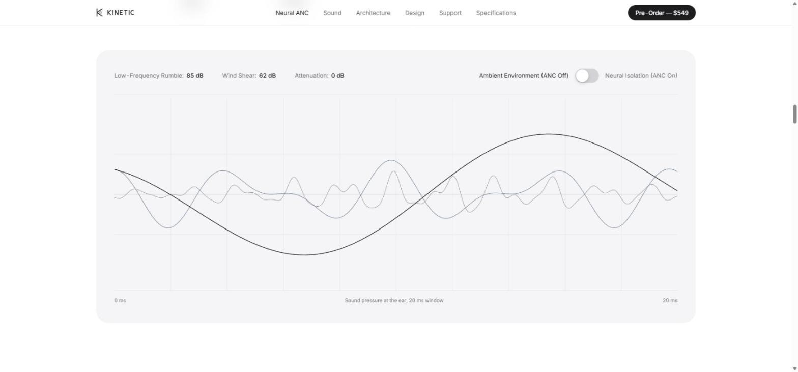
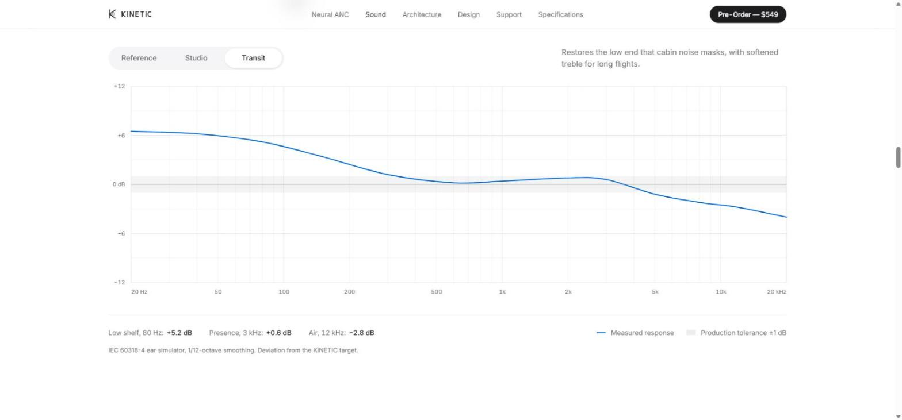
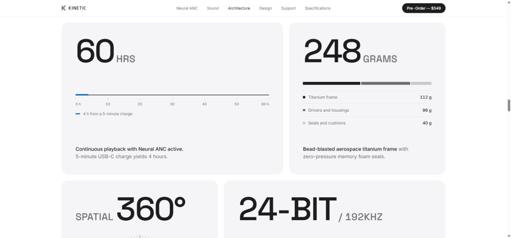
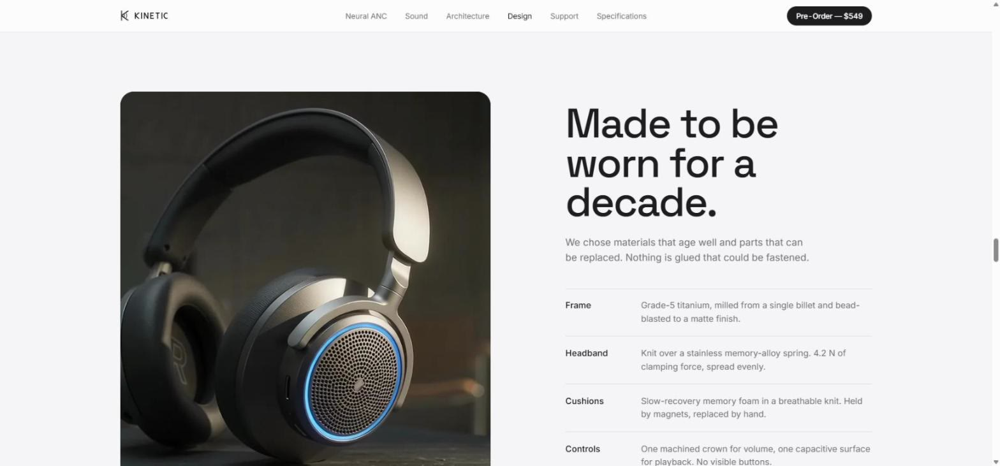
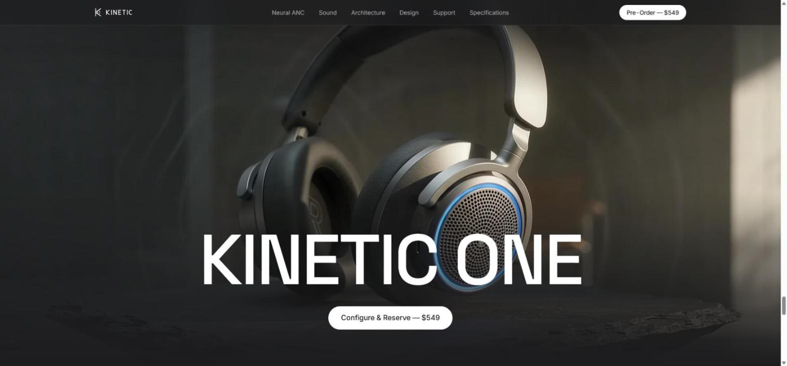
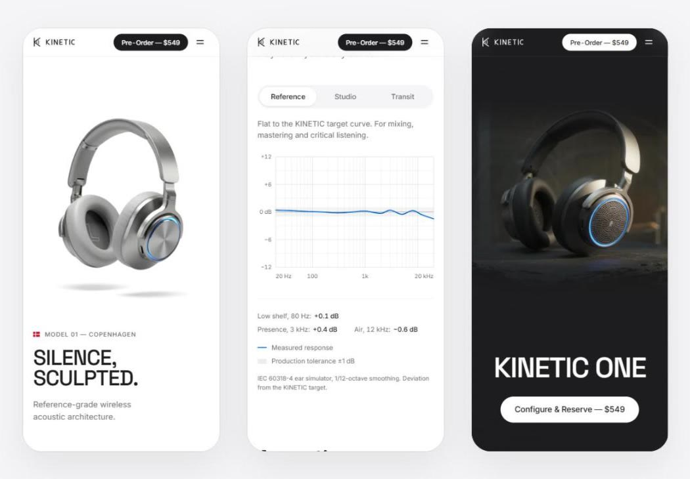
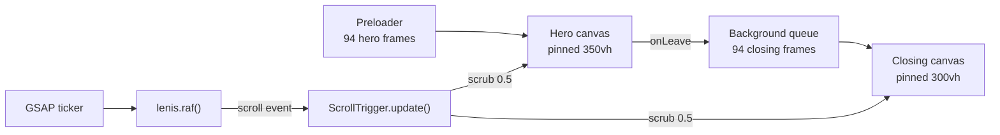

<div align="center">

<picture>
  <source media="(prefers-color-scheme: dark)" srcset="assets/readme/logo-dark.svg">
  
</picture>

<h3>KINETIC ONE — Acoustic Engineering, Copenhagen</h3>

<p>A scroll-driven product site for a fictional flagship headphone.<br>
Two 94-frame canvas sequences, a live noise-cancelling simulator and a measured frequency-response chart, built with the restraint of a Scandinavian hardware studio.</p>

<p>
  <a href="https://jhosuetortolero-lgtm.github.io/kinetic-one/"><strong>View the live site</strong></a>
  &nbsp;&nbsp;|&nbsp;&nbsp;
  <a href="#run-it-locally">Run it locally</a>
  &nbsp;&nbsp;|&nbsp;&nbsp;
  <a href="#how-the-scroll-scrubbing-works">How it works</a>
</p>

<p>
  
  
  
  
  
  
</p>

<br>



<sub>The 94-frame hero sequence, scrubbed by scroll on the live site.</sub>

</div>

<br>

## Overview

KINETIC ONE is a portfolio study: a complete product page for an invented Copenhagen audio brand, designed and engineered as if it were shipping. The brief was simple and strict. No generic gradients, no glow, no empty marketing words. Short technical copy, generous whitespace, hairline rules, tabular numbers, and motion that decelerates like a real object with mass.

<table>
  <tr>
    <td width="50%"></td>
    <td width="50%"></td>
  </tr>
  <tr>
    <td><sub><b>Hero.</b> The canvas lifts the studio-grey frames to pure white, so the product floats on the page with no visible edge.</sub></td>
    <td><sub><b>Exploded view.</b> A virtual camera slides the product away from each caption, so text never sits on the hardware.</sub></td>
  </tr>
</table>

## Highlights

| | Feature | What it does |
|---|---|---|
| 01 | **Pinned frame scrubbing** | Two `<canvas>` sequences of 94 WebP frames each, pinned for exactly 350vh and 300vh. Retina-aware, never crops the product. |
| 02 | **Smart loading** | The preloader fetches only the hero frames. The closing frames load silently, four at a time, once the visitor leaves the hero. |
| 03 | **Neural ANC simulator** | Live waveforms of rumble, ambience and wind collapse into one cobalt line when the switch turns on. Readouts fall from 85 dB to 37 dB. |
| 04 | **Frequency response** | A log-scale chart from 20 Hz to 20 kHz with three on-board profiles. The curve morphs point by point between them. |
| 05 | **Finish configurator** | Accessible drawer with three finishes, an optional case, live pricing and email validation. Finish chips elsewhere open it pre-selected. |
| 06 | **Responsive to the pixel** | Tested at 390, 768, 1024 and 1745 px wide. Dedicated menu below 1024 px, re-flowed charts, safe-area aware. |

## Screenshots

<table>
  <tr>
    <td width="50%"></td>
    <td width="50%"></td>
  </tr>
  <tr>
    <td><sub><b>Neural ANC.</b> Canvas waveforms, iOS-style switch, tabular readouts.</sub></td>
    <td><sub><b>Sound.</b> Measured response against a ±1 dB production tolerance band.</sub></td>
  </tr>
  <tr>
    <td></td>
    <td></td>
  </tr>
  <tr>
    <td><sub><b>Acoustic architecture.</b> Each figure carries its own small data diagram.</sub></td>
    <td><sub><b>Design.</b> Materials, finishes and a direct path into the configurator.</sub></td>
  </tr>
  <tr>
    <td></td>
    <td></td>
  </tr>
  <tr>
    <td><sub><b>Closing.</b> Second pinned sequence, cinematic and dark, flowing into the footer.</sub></td>
    <td><sub><b>On a phone.</b> Copy moves below the product; the chart keeps its key labels.</sub></td>
  </tr>
</table>

## How the scroll scrubbing works



- **One clock.** The GSAP ticker drives Lenis, and Lenis notifies ScrollTrigger in the same frame. Lenis scrolls the real window, so pinning needs no `scrollerProxy` and nothing drifts.
- **Exact heights.** Each pin ends at `innerHeight × 2.5` or `× 2.0`, re-evaluated on every refresh. `ignoreMobileResize` stops the mobile URL bar from shifting the pins.
- **Draw only on change.** A frame is redrawn only when the frame index or the camera changes. Missing frames fall back to the nearest loaded one, so scrubbing never shows a blank.
- **Pure-function camera.** The hero camera is computed from scroll progress, not tweened, so it stays correct on resize and when scrolling backwards.
- **Layout changes are re-measured.** Opening an FAQ answer changes the height above the closing pin. A `ResizeObserver` waits for the section to settle, then refreshes every trigger once.

## Design system

| Token | Value | Use |
|---|---|---|
| Pure Studio White |  `#FFFFFF` | Page background, hero canvas |
| Titanium Mist |  `#F5F5F7` | Cards, panels, Design section |
| Anodized Graphite |  `#1D1D1F` | Text, closing scene, footer |
| Secondary text |  `#6E6E73` | Supporting copy, labels |
| Electric Cobalt |  `#0066CC` | Engineering focal points only |

- **Type:** Space Grotesk for display, set at `-0.03em`. Inter for text and data, with `tabular-nums` on every measured value.
- **Motion:** `cubic-bezier(0.16, 1, 0.3, 1)` and `power3.out` everywhere. No bounce, no elastic. Buttons press to `scale(0.98)`.
- **Detail:** 1 px hairlines at `rgba(0, 0, 0, 0.08)`, visible `:focus-visible` rings, and `prefers-reduced-motion` respected throughout.

## Tech stack

| Layer | Choice |
|---|---|
| Markup | Semantic HTML5, one page, no framework |
| Styling | Tailwind CSS 3.4 (CDN) with component layers in `text/tailwindcss` |
| Motion | GSAP 3.12 and ScrollTrigger |
| Smooth scroll | Lenis 1.1, driven by the GSAP ticker |
| Graphics | `<canvas>` for frame sequences and waveforms, inline SVG for charts and the logotype |
| Media | WebP frames extracted with FFmpeg |
| Hosting | GitHub Pages, served straight from `main` |

## Project structure

```text
kinetic-one/
├── index.html              # Markup, design tokens and component styles
├── js/
│   └── main.js             # Frame loader, scroll scrubbing, ANC, chart, drawer, menu
├── public/
│   ├── frames-hero/        # frame_0001.webp … frame_0094.webp
│   └── frames-closing/     # frame_0001.webp … frame_0094.webp
├── assets/readme/          # Screenshots, preview GIF, logo, social image
└── .nojekyll               # Serve files as-is on GitHub Pages
```

## Run it locally

No install and no build step. Any static server works:

```bash
git clone https://github.com/jhosuetortolero-lgtm/kinetic-one.git
cd kinetic-one
python -m http.server 5173
# open http://127.0.0.1:5173
```

Or with Node: `npx serve .`

## Regenerate the frames

The frames come from two 1920 × 1080 source videos at 24 fps. The frame counts live at the top of `js/main.js`.

```bash
ffmpeg -i Video01.mp4 -an -vf "fps=24,scale=1920:-2:flags=lanczos" -c:v libwebp -quality 82 public/frames-hero/frame_%04d.webp
ffmpeg -i Video02.mp4 -an -vf "fps=24,scale=1920:-2:flags=lanczos" -c:v libwebp -quality 82 public/frames-closing/frame_%04d.webp
```

```js
const HERO_TOTAL_FRAMES = 94;
const CLOSING_TOTAL_FRAMES = 94;
```

## Accessibility and performance

- Real text for every caption, with canvases marked `aria-hidden`.
- The configurator is a true modal: focus trap, `Escape` to close, background set to `inert`, focus returned on close.
- The ANC switch uses `role="switch"`. The sound profiles are a keyboard-navigable `radiogroup`.
- Device pixel ratio is capped at 2, canvases draw only when something changes, and the ANC animation pauses when off-screen.
- With `prefers-reduced-motion`, smooth scrolling and decorative motion are switched off. Scroll-driven frames still follow the scrollbar directly.

<details>
<summary><b>Versão em português</b></summary>
<br>

**KINETIC ONE** é um estudo de portfólio: o site completo de produto de uma marca fictícia de áudio de Copenhague, feito como se fosse para lançamento real.

- Duas sequências de 94 frames em `<canvas>`, fixadas por exatamente 350vh e 300vh, controladas pela rolagem.
- O preloader carrega só os frames do hero. Os frames do final carregam em segundo plano depois que o visitante sai do hero.
- Simulador de cancelamento de ruído com ondas ao vivo e gráfico de resposta de frequência com três perfis.
- Configurador de acabamento acessível, menu próprio para celular e tablet, testado de 390 px a 1745 px.

Para rodar localmente: `python -m http.server 5173` e abra `http://127.0.0.1:5173`.

</details>

<br>

<div align="center">

**Designed and developed by Dev. Jhosue Tortolero, Jhosuelabs.**

<sub>KINETIC is a fictional brand created for this portfolio. No product is sold and no order is placed.</sub>

</div>
